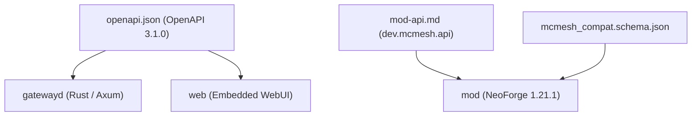

<div align="center">

# mcmesh-docs

**Official API specifications, JSON schemas, and developer documentation for mcmesh.**

[](https://github.com/mcmeshsolutions/docs/actions/workflows/ci.yml)
[](./openapi.json)
[](./mcmesh_compat.schema.json)
[](https://github.com/mcmeshsolutions/docs/commits/main)

[Contents](#contents) | [Architecture](#architecture-overview) | [OpenAPI Preview](#using-the-openapi-spec) | [Testing](#testing)

</div>

---

## Overview

`mcmesh-docs` is the canonical home for [mcmesh](https://github.com/mcmeshsolutions) wire contracts, REST/SSE API definitions, mod compatibility schemas, and developer guides.

## Contents

| File | Description |
|---|---|
| [`openapi.json`](./openapi.json) | Complete **OpenAPI 3.1.0** specification for `gatewayd` HTTP REST & SSE endpoints |
| [`mod-api.md`](./mod-api.md) | Developer guide for `dev.mcmesh.api` (`MeshApi`, `MeshWorld`, `MeshEvent`, `MeshRole`, `MeshState`) |
| [`mcmesh_compat.schema.json`](./mcmesh_compat.schema.json) | JSON Schema (Draft 2020-12) for `data/<modid>/mcmesh_compat.json` declarative mod sync rules |
| [`marketing.html`](./marketing.html) | Self-contained product overview, architecture breakdown, and community reference page |
| [`marketing-strategy.html`](./marketing-strategy.html) | Go-to-market and closed-beta rollout plan |

## Architecture Overview



1. **`gatewayd` ([mcmeshsolutions/gatewayd](https://github.com/mcmeshsolutions/gatewayd)):**
   - Stores world revisions as content-addressed SHA-256 blobs (`cas/`) with Ed25519 host signatures and hash chains.
   - Coordinates epoch-fenced host leases, failover elections, and multi-tenant world quotas.
   - Relays guest connections (`:25565` TCP) and Simple Voice Chat (`:24454` UDP) when direct P2P hole-punching is unavailable.
   - Replicates hot SQLite WAL snapshots and CAS blobs asynchronously to S3 / Cloudflare R2 / MinIO.
2. **`mod` ([mcmeshsolutions/mod](https://github.com/mcmeshsolutions/mod)):**
   - Syncs changed chunks and auxiliary mod files before hosting.
   - Streams delta WAL frames during gameplay and executes zero-disconnect handovers when the host exits.

## Using the OpenAPI Spec

Preview the interactive API reference or generate typed client SDKs directly from [`openapi.json`](./openapi.json):

```bash
# Preview locally with Redocly CLI
npx @redocly/cli preview-docs openapi.json

# Lint the OpenAPI specification
npx @redocly/cli lint openapi.json
```

## Testing

Run the Python standard-library validation suite to verify `openapi.json` (`$ref` resolution, operations, responses), `mcmesh_compat.schema.json`, relative markdown links, and HTML documents:

```bash
python3 -m unittest discover -s tests -v
```

## Ecosystem

| Repository | Description |
|---|---|
| [mcmeshsolutions/gatewayd](https://github.com/mcmeshsolutions/gatewayd) | Coordination gateway daemon, CAS store, and relay |
| [mcmeshsolutions/mod](https://github.com/mcmeshsolutions/mod) | Minecraft NeoForge 1.21.1 client and host mod |
| [mcmeshsolutions/web](https://github.com/mcmeshsolutions/web) | WebUI panel, 3D voxel viewer, and spatial inspectors |
| [mcmeshsolutions/deploy](https://github.com/mcmeshsolutions/deploy) | Docker Compose, systemd, Caddy TLS, and homelab templates |
| [mcmeshsolutions/docs](https://github.com/mcmeshsolutions/docs) | OpenAPI 3.1.0 spec, JSON schemas, and mod API docs (this repo) |

---

<div align="center">
<sub>Not affiliated with Mojang or Microsoft.</sub>
</div>
